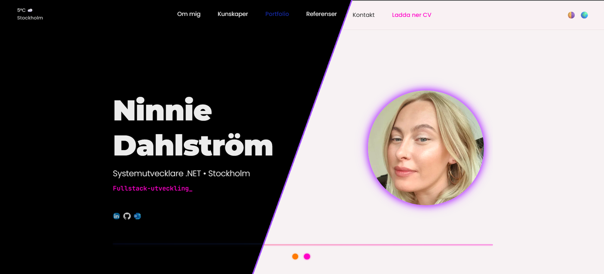

# 🌐 WebbPortfolio - Ninnie Dahlström

**Live:** https://nninnie.se · **Kod:** https://github.com/nninnie/webbportfolio · **English version:** https://nninnie.se/index-en.html

<p align="center">
  
</p>

En responsiv webbportfolio byggd med **HTML**, **CSS** och **JavaScript**, utan ramverk.
Portfolion visar vem jag är, vad jag kan, mina projekt, referenser och hur man kontaktar mig. Kontaktdelen är byggd som en enhet i Samsung One UI-stil som blir telefon, surfplatta eller laptop beroende på skärmen.

---

## ✨ Funktionalitet

### 🌓 Mörkt och ljust läge
- Tema-knapp i navbaren
- Glöd-effekter och glaskort (glassmorphism) i båda teman
- CV-knappen laddar ner rätt CV för språket och temat: svenska eller engelska, mörkt eller ljust (`theme.js`)

### 🎨 Glödfärg
- Två färgväljare (`<input type="color">`), en för mörkt läge och en för ljust läge
- Färgen sätts i CSS-variabeln `--glow` och ändras direkt på hela sidan

### 🌐 Svenska och engelska
- Svensk version (`index.html`) och engelsk version (`index-en.html`)
- Språkknappen växlar mellan sidorna
- `utils.js` läser av vilken sida som visas, och modulerna väljer rätt texter (väder, projekt, formulär, datum)
- Dold `<select>` med label för skärmläsare

### 🌦️ Väder (Open-Meteo API)
- Hämtar aktuell temperatur och väderkod för Stockholm med `fetch()` och `async/await`
- En tabell (`WEATHER_CODES`) med ikon och text på svenska och engelska för varje väderkod
- Vädret visas i navbaren, i väderrutan och i laptopens aktivitetsfält
- Anropet avbryts efter 5 sekunder (`AbortSignal.timeout`), och vid fel visas "Väder saknas"

### 📁 Projekt
- Projekten ligger som data i `projects.js`, och korten skapas med JavaScript
- Klick på ett kort öppnar en popup med beskrivning, funktioner, GitHub-länk och demo-länk
- Ett nytt projekt läggs till med ett objekt i listan i `projects.js`

### 💬 Referenser
- Referenserna visas som en slider med `scroll-behavior: smooth`

### 📱 Kontakt som enhet (Samsung One UI)
- Samma HTML visas som telefon (mobil), surfplatta och laptop med media queries
- Klocka och datum uppdateras med JavaScript (`device-clock.js`)
- Infokort för LIA och utbildning, som uppdateras direkt i HTML
- Appikoner för telefon, SMS, WhatsApp, Outlook, Gmail, LinkedIn, GitHub och kontaktformulär
- På dator kopierar telefonikonen numret och SMS öppnar WhatsApp Web. På pekskärm, som känns igen med `matchMedia("(pointer: coarse)")`, öppnas telefonens appar.

### 📨 Kontaktformulär
- Skickas med FormSubmit via `fetch` (AJAX), utan sidladdning
- Egen validering med felmeddelande per fält och `aria-invalid`
- Fälten trimmas, så mellanslag i början och slutet skickas inte med
- Knappen låses medan meddelandet skickas, så det blir inga dubbla mejl
- Honeypot-fältet `_honey` som spamskydd
- Statusmeddelande när det har lyckats eller misslyckats

### 🧭 Navigation
- Navbar som ligger kvar överst vid scroll
- Mobilmeny (hamburgare) på små skärmar
- Skip-link till innehållet

---

## 🧱 Arkitektur

### HTML – struktur
- Semantiska element (`header`, `nav`, `section`, `footer`)
- Sektionerna Hero, Om mig, Kunskaper, Portfolio, Referenser och Kontakt
- Alt-texter på bilder och `aria-label` på ikonknappar

### CSS – design och layout
- En CSS-fil per sektion i mappen `css/`, laddade i kaskadordning
- Färger och glöd som CSS-variabler i `base.css`
- Ljust tema i `theme-light.css`, som laddas sist
- Flexbox, CSS Grid och `clamp()` för storlekar
- Media queries för mobil, surfplatta (768 px) och laptop (1200 px)

### JavaScript – funktionalitet
- ES-moduler (`import`/`export`) i mappen `js/`, en modul per ansvar
- `main.js` är startpunkten som startar alla moduler

| Modul | Ansvar |
|---|---|
| `main.js` | Startar alla moduler |
| `utils.js` | Gemensamma hjälpfunktioner, till exempel `isEnglishPage` och `setText` |
| `theme.js` | Mörkt/ljust läge, språkknapp, glödfärg och CV per språk och tema |
| `weather.js` | Hämtar och visar väder från Open-Meteo |
| `device-clock.js` | Klocka och datum i enhetens statusrad |
| `navbar.js` | Mobilmeny och navbar vid scroll |
| `hero-typing.js` | Skrivmaskinseffekten i hero |
| `contact.js` | Kontakt-popup, formulärvalidering, AJAX, telefon/SMS/mejl och toast |
| `projects.js` | Projektdata, projektkort och projekt-popup |

---

## ♿ Tillgänglighet

Det här finns i koden:

- Semantisk HTML
- Alt-texter på bilder
- `aria-label` och `aria-invalid` i formuläret
- Skip-link till innehållet
- Synlig fokusmarkering (`:focus-visible`) på enhetens ikoner
- Dold `<select>` med label för språkval

---

## 📊 Lighthouse

Uppmätt **2026-11-27** mot https://nninnie.se med Lighthouse 12.2.1 i Chrome.

| | Prestanda | Tillgänglighet | Best practices | SEO |
|---|---|---|---|---|
| Mobil | 59 | 80 | 96 | 100 |
| Dator | 84 | 86 | 96 | 100 |

Det här ska förbättras:

- **Prestanda:** typsnitt och ikoner laddas innan sidan visas, vilket ger lång laddtid på mobil (första innehållet efter 7,1 s i Lighthouses simulerade 4G)
- **Kontrast:** några färgade texter har för låg kontrast mot bakgrunden
- **Rubriker:** rubriknivåerna hoppar över steg
- **Knappar och ARIA:** några knappar saknar namn för skärmläsare, och några element har ARIA-attribut som inte är tillåtna
- **Pekytor:** några länkar och knappar är för små eller ligger för tätt på mobil

---

## 🧪 Tekniker

- HTML5
- CSS3
- JavaScript (ES6+, ES-moduler)
- Open-Meteo API (väder, ingen nyckel behövs)
- FormSubmit (kontaktformulär)
- Devicon (teknikikoner)

---

## 📁 Projektstruktur

```
webbportfolio/
├── index.html          # svensk version
├── index-en.html       # engelsk version
├── css/                # en fil per sektion (ordningen spelar roll)
│   ├── base.css        # variabler, typsnitt, body
│   ├── navbar.css · hero.css · about.css · skills.css
│   ├── portfolio.css · references.css
│   ├── contact-form.css · contact-device.css · contact-popup.css
│   ├── footer.css
│   └── theme-light.css # ljust tema, laddas sist
├── js/                 # ES-moduler
│   ├── main.js         # startpunkt
│   ├── utils.js · theme.js · weather.js · device-clock.js
│   └── navbar.js · hero-typing.js · contact.js · projects.js
├── image/
│   ├── icons/          # ikoner i kontaktdelen
│   ├── portfolio/      # skärmbilder till projekten
│   ├── cv-ninnie-dahlstrom*.pdf   # CV: svenska/engelska, mörkt/ljust
│   └── portrait-ninnie-dahlstrom.webp
├── CNAME               # egen domän (nninnie.se)
└── README.md
```

---

## 🛠️ Kör lokalt

ES-moduler kräver en webbserver. Att dubbelklicka på `index.html` fungerar inte.

1. Klona projektet
2. Öppna mappen i VS Code
3. Starta med **Live Server**, eller kör `npx http-server` i mappen

Ingen installation eller byggsteg behövs, eftersom projektet är helt statiskt. Sajten ligger på GitHub Pages med egen domän.

---

## 🧩 Arbetssätt och lärdomar

Principer jag har följt:

- **Single Responsibility Principle:** varje JS-modul och funktion har ett ansvar
- **Separation of concerns:** en CSS-fil och en JS-modul per del av sidan
- **Iterativ design:** bygga, testa, förbättra
- **Git:** en branch per funktion och Conventional Commits (`feat:`, `fix:`, `docs:`, `refactor:`)

Lärdomar:

- Att planera komponenter först sparar mycket tid
- `clamp()` är mycket användbart för responsiv design
- Ljust läge kräver mer arbete med kontrast än mörkt läge
- Väder-API:et gav bättre förståelse för asynkron JavaScript och felhantering

---

## ✍️ Utvecklat av
**Ninnie Dahlström** · [nninnie.se](https://nninnie.se) · [GitHub](https://github.com/nninnie) · [LinkedIn](https://linkedin.com/in/ninnie-dahlstrom)
