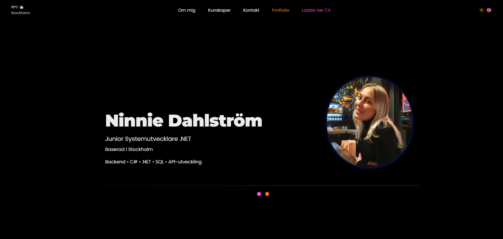

# 🌐 WebbPortfolio - Ninnie Dahlström

  

En modern, responsiv och tillgänglig webportfolio byggd med **HTML**, **CSS** och **JavaScript**.  
Projektet är utvecklat med fokus på UI/UX‑design, komponentbaserad struktur, API‑integration och ren, modulär kod.  
Portfolion presenterar mina projekt, erfarenheter och kontaktmöjligheter i ett visuellt premium‑gränssnitt inspirerat av Samsung‑design och modern webbestetik.

---

## ✨ Funktionalitet

### 🌓 Dark & Light Mode
- Tema‑toggle med ikon  
- Glow‑effekter och glassmorphism  
- Färgpalett anpassad för båda teman  
- LocalStorage sparar användarens val  

### 🌦️ Väder‑API
- Integration med **Open‑Meteo API**
- Hämtar temperatur och väderkod baserat på koordinater
- Dynamisk ikon baserat på Open‑Meteos weather codes
- Asynkron hämtning med `fetch()` och JSON‑hantering
- Felhantering om API inte svarar

### 📱 Responsiv design
- `clamp()` för typografi och spacing  
- Flexbox och CSS Grid  
- Media queries för mobil, tablet och laptop  
- Mobilanpassad slider i referenssektionen  

### 📨 Kontaktformulär
- FormSubmit‑integration  
- HTML5‑validering  
- Custom felmeddelanden  
- Bekräftelse‑popup vid skickat meddelande  

### 🧭 Navigation
- Sticky navbar  
- Smooth scroll  
- Skip‑link för tillgänglighet  
- Ikoner för språk, tema och väder  

---

## 🧱 Arkitektur

Projektet är uppdelat i tydliga lager för att hålla koden ren, skalbar och lätt att underhålla.

### **HTML – Struktur**
- Semantiska element  
- Tydliga sektioner (Hero, About, Skills, Projects, References, Contact)  
- Aria‑labels och alt‑texter  
- Fokus på WCAG‑principer  

### **CSS – Design & Layout**
- Modulär CSS  
- Variabler för färger och teman  
- Glassmorphism, glow och micro‑interactions  
- Responsiv layout med flex/grid  
- Komponentbaserad styling  

### **JavaScript – Funktionalitet**
- Små, separata funktioner  
- Tema‑hantering  
- Väder‑API  
- Formulärvalidering  
- Slider‑logik  
- UI‑interaktioner  
- Scroll‑effekter  

---

## 🖥️ UI‑lager

UI‑lagret består av flera komponenter:

- **ThemeToggle** – hanterar dark/light mode  
- **WeatherWidget** – hämtar och visar väderdata  
- **LanguageToggle** – språkikon (visuell)  
- **Slider** – mobilanpassad referensslider  
- **FormHandler** – validering och feedback  
- **ScrollEffects** – smooth scroll och navbar‑logik  
- **ModalRenderer** – projektmodals med GitHub/README‑länkar  

Varje komponent har ett tydligt ansvar, vilket gör koden lätt att bygga ut och underhålla.

---

## ♿ WCAG & Tillgänglighet

- Semantisk HTML  
- Alt‑texter  
- Aria‑labels  
- Fokusmarkeringar  
- Skip‑link  
- Kontrastkontroll i båda teman  
- Tangentbordsnavigering  

---

## 🧪 Tekniker

- HTML5  
- CSS3  
- JavaScript (ES6)  
- OpenWeatherMap API  
- FormSubmit  
- LocalStorage  

---

## 📁 Projektstruktur

Projektet är enkelt strukturerat och innehåller endast de filer som behövs för portfolion.

/image
(endast bilder – ikoner, projektbilder, referensbilder)

index.html
index-en.html
style.css
script.js
README.md
readme-image.png

---

## 🛠️ Installation

1. Klona projektet  
2. Öppna projektmappen  
3. Starta genom att öppna **index.html** i valfri webbläsare  

Ingen installation krävs — projektet är helt statiskt.

---

## 📄 Dokumentation

- Figma‑skisser (internt)  
- Moodboard (internt)  
- Komponentplanering  
- UI‑system (spacing, färger, typografi)  

---

## 🧩 Lärdomar & Arbetssätt

Jag arbetade enligt principer som:

- **Single Responsibility Principle** – varje JS‑funktion gör en sak  
- **Modulär CSS i en fil** – komponentbaserad styling i sektioner  
- **Iterativ design** – bygga → testa → förbättra  
- **Responsiv först** – mobil → tablet → laptop  

Lärdomar:

- Jag hade velat börja i Figma tidigare  
- Att planera komponenter sparar mycket tid  
- `clamp()` är extremt kraftfullt för responsivitet  
- Light mode kräver mer kontrastarbete än dark mode  
- API‑integration gav bättre förståelse för asynkron JavaScript  

---

## ✍️ Utvecklat av  
**Ninnie Dahlström – Web Portfolio**
