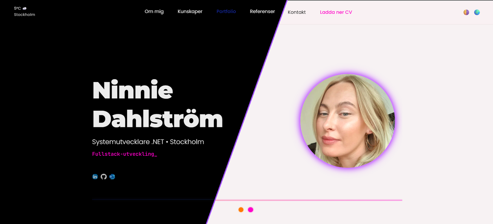

# 🌐 WebbPortfolio - Ninnie Dahlström

<p align="center">
  
</p>

En modern, responsiv och tillgänglig webportfolio byggd med **HTML**, **CSS** och **JavaScript**.  
Projektet är utvecklat med fokus på UI/UX‑design, komponentbaserad struktur, API‑integration och ren, modulär kod.  
Portfolion presenterar mina projekt, erfarenheter och kontaktmöjligheter i ett visuellt premium‑gränssnitt inspirerat av Samsung‑design och modern webbestetik.

---

## ✨ Funktionalitet

### 🌓 Dark & Light Mode
- Tema‑toggle med ikon  
- Glow‑effekter och glassmorphism  
- Färgpalett anpassad för båda teman  
- CV:t som laddas ner följer temat (mörkt/ljust)  

### 🌐 Språkväxling (Language Toggle)
- Svensk (`index.html`) och engelsk (`index-en.html`) version
- Språkknappen växlar mellan sidorna
- JavaScript läser av sidans språk och visar rätt texter (väder, projekt, formulär)
- Dold `<select>` med label för skärmläsare

### 🌦️ Väder‑API
- Integration med **Open‑Meteo API**
- Hämtar temperatur och väderkod baserat på koordinater
- Dynamisk ikon baserat på Open‑Meteos weather codes
- Asynkron hämtning med `fetch()` och JSON‑hantering
- Felhantering om API inte svarar

### 📱 Responsiv design
- `clamp()` för typografi och spacing  
- Flexbox och CSS Grid  
- Media queries för mobil, tablet och laptop  
- Mobilanpassad slider i referenssektionen  

### 📱 Kontakt som enhet (Samsung / One UI)
- Samma HTML visas som telefon (mobil), surfplatta och laptop via media queries
- Klocka, datum och väder uppdateras med JavaScript
- Bakgrunden är ren CSS och följer tema och glödfärg

### 📨 Kontaktformulär
- FormSubmit via AJAX (`fetch`) – ingen sidladdning  
- Egen validering med tydliga felmeddelanden per fält (`aria-invalid`)  
- Knappen låses under skick (inga dubbla mejl)  
- Honeypot‑fält som spamskydd  
- Statusmeddelande vid lyckat/misslyckat skick  

### 🧭 Navigation
- Sticky navbar  
- Smooth scroll  
- Skip‑link för tillgänglighet  
- Ikoner för språk, tema och väder  

### ✨ Glow Color Picker
- CSS‑variabler för att styra glow‑färgen
- JavaScript som lyssnar på input‑event
- Direkt DOM‑uppdatering i realtid
- Skapa en mer levande och personlig UI‑upplevelse
- Ge användaren kontroll över designen
- Visa interaktivitet och modern frontend‑teknik

---

## 🧱 Arkitektur

Projektet är uppdelat i tydliga lager för att hålla koden ren, skalbar och lätt att underhålla.

### **HTML – Struktur**
- Semantiska element  
- Tydliga sektioner (Hero, About, Skills, Projects, References, Contact)  
- Aria‑labels och alt‑texter  
- Fokus på WCAG‑principer  

### **CSS – Design & Layout**
- En CSS‑fil per sektion i mappen `css/`, laddade i kaskadordning  
- Variabler för färger och teman  
- Glassmorphism, glow och micro‑interactions  
- Responsiv layout med flex/grid  
- Komponentbaserad styling  

### **JavaScript – Funktionalitet**
- ES‑moduler (`import`/`export`) i mappen `js/` – en modul per ansvar  
- `main.js` är startpunkten som startar alla moduler  
- Tema, väder‑API, formulärvalidering, projekt och navbar i egna filer  

---

## 🖥️ UI‑lager

UI‑lagret består av flera komponenter:

- **theme.js** – dark/light mode, språkknapp, glödfärg och CV per tema  
- **weather.js** – hämtar och visar väderdata (Open‑Meteo)  
- **device-clock.js** – klocka och datum i enhetens statusrad  
- **navbar.js** – mobilmeny och navbar vid scroll  
- **hero-typing.js** – skrivmaskinseffekten i hero  
- **contact.js** – popup, formulärvalidering, AJAX och toast  
- **projects.js** – projektdata, projektkort och projekt‑popup  

Varje komponent har ett tydligt ansvar, vilket gör koden lätt att bygga ut och underhålla.

---

## ♿ WCAG & Tillgänglighet

- Semantisk HTML  
- Alt‑texter  
- Aria‑labels  
- Fokusmarkeringar  
- Skip‑link  
- Kontrastkontroll i båda teman  
- Tangentbordsnavigering  

---

## 🧪 Tekniker

- HTML5  
- CSS3  
- JavaScript (ES6+, ES‑moduler)  
- Open‑Meteo API  
- FormSubmit (AJAX)  
- Devicon (teknikikoner)  

---

## 📁 Projektstruktur

Projektet är enkelt strukturerat och innehåller endast de filer som behövs för portfolion.

```
webbportfolio/
├── index.html          # svensk version
├── index-en.html       # engelsk version
├── css/                # en fil per sektion (ordningen spelar roll)
│   ├── base.css        # variabler, typsnitt, body
│   ├── navbar.css · hero.css · about.css · skills.css
│   ├── portfolio.css · references.css
│   ├── contact-form.css · contact-device.css · contact-popup.css
│   ├── footer.css
│   └── theme-light.css # ljust tema – laddas sist
├── js/                 # ES-moduler
│   ├── main.js         # startpunkt
│   ├── utils.js · theme.js · weather.js · device-clock.js
│   └── navbar.js · hero-typing.js · contact.js · projects.js
├── image/              # bilder, ikoner och CV
├── CNAME               # egen domän (nninnie.se)
└── README.md
```

---

## 🛠️ Installation

1. Klona projektet  
2. Öppna projektmappen  
3. Starta med **Live Server** i VS Code (ES‑moduler kräver en webbserver – att dubbelklicka på index.html fungerar inte)  

Ingen installation krävs — projektet är helt statiskt. Live: **https://nninnie.se**

---

## 📄 Dokumentation

- Figma‑skisser (internt)  
- Moodboard (internt)  
- Komponentplanering  
- UI‑system (spacing, färger, typografi)  

---

## 🧩 Lärdomar & Arbetssätt

Jag arbetade enligt principer som:

- **Single Responsibility Principle** – varje JS‑funktion gör en sak  
- **Separation of concerns** – en CSS‑fil och en JS‑modul per del av sidan  
- **Iterativ design** – bygga → testa → förbättra  
- **Responsiv först** – mobil → tablet → laptop  

Lärdomar:

- Jag hade velat börja i Figma tidigare  
- Att planera komponenter sparar mycket tid  
- `clamp()` är extremt kraftfullt för responsivitet  
- Light mode kräver mer kontrastarbete än dark mode  
- API‑integration gav bättre förståelse för asynkron JavaScript  

---

## ✍️ Utvecklat av  
**Ninnie Dahlström – Web Portfolio**
